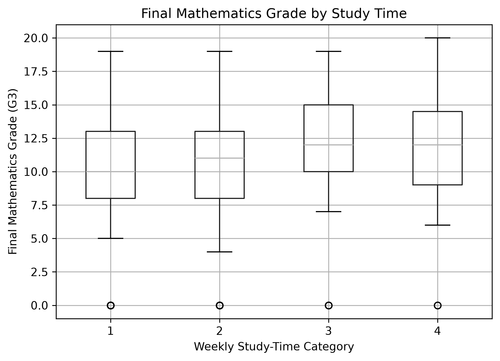

Student Study Time Research Report

1. Introduction

Study habits may be associated with students' academic performance. This project investigates whether weekly study time is associated with final mathematics grades using statistical analysis in Python.

2. Research Question

Is weekly study time associated with students' final mathematics grade?

3. Objectives

- To compare final mathematics grades across weekly study-time categories.
- To measure the association between weekly study time and final mathematics grade.
- To interpret the findings using statistical tests and a box plot.

4. Dataset Description

The study uses the Student Performance Mathematics dataset from the UCI Machine Learning Repository.

The unit of analysis is an individual student. The dataset contains 395 eligible student records for this analysis.

The predictor variable is "studytime", which represents weekly study-time categories. The outcome variable is "G3", the final mathematics grade measured on a scale from 0 to 20.

Records with missing or invalid values in these variables are excluded. No control variables are used in the primary analysis.

5. Methodology

Python was used to load, process, and analyse the dataset.

The following libraries were used:

- Pandas for data handling.
- SciPy for statistical testing.
- Matplotlib for visualization.

5.1 Kruskal–Wallis H Test

The Kruskal–Wallis H test was used to compare final mathematics grade distributions across the four study-time categories.

5.2 Spearman Rank Correlation

Spearman rank correlation was used to assess the direction and strength of the monotonic association between study time and final mathematics grade.

5.3 Effect Size

Epsilon-squared was calculated to describe the magnitude of the differences across study-time categories.

5.4 Visualization

A box plot was generated to compare final mathematics grades across the study-time categories.

6. Results

The analysis included 395 student records.

Statistical measure| Result
Kruskal–Wallis H statistic| 7.5789
Kruskal–Wallis p-value| 0.0556
Epsilon-squared| 0.0117
Spearman correlation coefficient| 0.1052
Spearman p-value| 0.0367

6.1 Kruskal–Wallis Test Interpretation

The p-value was 0.0556, which is greater than the significance level of 0.05. Therefore, the null hypothesis was not rejected. The test did not provide sufficient evidence of differences in final mathematics grade distributions across the four study-time categories.

The epsilon-squared estimate was 0.0117, indicating a small effect.

6.2 Spearman Correlation Interpretation

The Spearman correlation coefficient was 0.1052, indicating a very weak positive monotonic association between weekly study time and final mathematics grade.

The p-value was 0.0367, which is below 0.05. Therefore, the result was statistically significant at the specified significance level.

The correlation does not establish that increased study time causes higher mathematics grades.

7. Visualization

The box plot below compares final mathematics grades ("G3") across the four weekly study-time categories.

Figure 1: Distribution of final mathematics grades across study-time categories 1, 2, 3, and 4.

The box plot displays the median, spread, and potential outliers in the final mathematics grades for each category. It helps visually compare grade distributions across the study-time groups.

8. Discussion

The two statistical tests produced different significance results. The Kruskal–Wallis test did not find statistically significant differences across the study-time groups at the 0.05 level, whereas Spearman correlation detected a statistically significant but very weak positive association.

These findings are not necessarily contradictory because the tests examine different aspects of the data. The results suggest that the relationship between weekly study time and final mathematics grade is limited and should not be interpreted as evidence of causation.

Other factors, such as prior academic performance, attendance, family background, and learning conditions, may also be related to academic outcomes. These factors were not controlled for in this analysis.

9. Limitations

- The analysis is based on one mathematics dataset and may not generalize to all students.
- The study is observational and cannot establish causation.
- No control variables were included in the primary analysis.
- The analysis does not establish that study time alone determines academic performance.
- Confidence intervals were not calculated in the current analysis.
- The effect-size estimate should be interpreted alongside its documented formula and the statistical test results.

10. Conclusion

This project examined the relationship between weekly study time and final mathematics grades using the UCI Student Performance Mathematics dataset.

The Kruskal–Wallis test did not find statistically significant differences across study-time categories at the 0.05 significance level. Spearman correlation indicated a statistically significant but very weak positive association.

Overall, the findings suggest a limited relationship between weekly study time and final mathematics grade. Further research incorporating additional variables and uncertainty estimates would help provide a more comprehensive understanding of students' academic performance.

11. Reproducibility

The analysis code is available in "src/analysis.py". The dataset is stored in the "raw" folder, and the generated visualization is saved in the "reports" folder.

To run the analysis from the project root directory, execute:

python src/analysis.py

The required Python libraries are listed in "requirements.txt".